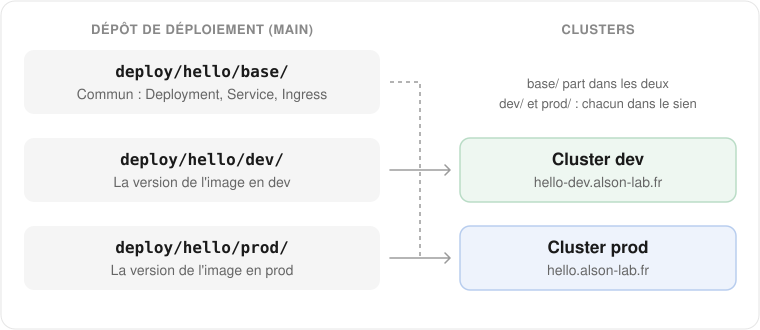
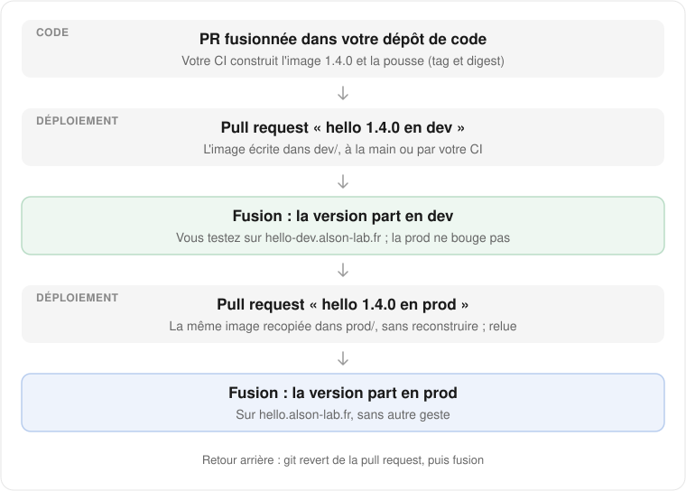

# Usage courant (guide des équipes, niveau 2)

Vous avez suivi le tutoriel du [modèle](https://github.com/aslon/homelab-tenant-template) et votre page tourne en dev.
Ce guide couvre le quotidien : comprendre ce qui se passe, livrer une version, passer en prod, gérer les secrets et
les accès. Les règles exactes, les quotas et le dépannage sont dans la [référence](reference.md).

Dans les exemples, `monequipe` est votre équipe et `hello` votre app.

| Je veux… | Aller à |
|---|---|
| Remplacer la page d'exemple par mon application | [Déployer votre propre application](#déployer-votre-propre-application) |
| Déployer une nouvelle version | [Livrer une version](#livrer-une-version) |
| Passer en production | [Passer en production, la première fois](#passer-en-production-la-première-fois) |
| Voir les journaux de mon application | [Vos accès](#vos-accès) |
| Utiliser `kubectl` | [kubectl sur dev](#kubectl-sur-dev) |
| Configurer un secret | [Secrets](#secrets) |
| Ajouter une base de données | [Vos données](#vos-données), [exemple SQLite](#exemple--une-app-avec-une-base-sqlite) |
| Garder mon image privée | [Image publique ou privée](#image-publique-ou-privée) |
| Comprendre un refus ou une erreur | [Dépannage](reference.md#dépannage) |

## Comment ça marche

Le principe (GitOps) : **l'état souhaité est décrit dans git**. Vous ne poussez rien vers le cluster ; vous écrivez
dans un dépôt ce qui doit tourner, et Argo CD l'applique.

### Deux dépôts, deux rôles

| Dépôt | Contient | Qui y écrit | Ce qu'il produit |
|---|---|---|---|
| **Code** (`monequipe/hello`) | le code de l'app, son `Dockerfile` | les développeurs | une **image** (`ghcr.io/monequipe/hello:1.4.0@sha256:…`), construite par votre CI |
| **Déploiement** (`monequipe/monequipe-deploy`, créé depuis le modèle) | les manifests Kubernetes, et **quelle image** tourne dans chaque environnement | vous, ou votre CI par PR | ce que les clusters appliquent |

Le homelab ne lit **que le dépôt de déploiement**, et seulement sa branche `main`. Il ne voit jamais votre code.
Séparer les deux est la pratique recommandée par Argo CD : un commit de code ne change rien en production tant
qu'une PR du dépôt de déploiement ne l'y fait pas entrer (si votre CI fusionne elle-même ces PR, cette garantie
disparaît). L'historique de `main` est celui de l'**état voulu** ; ce qui a réellement tourné (livraison refusée,
pod en échec) se lit dans Argo CD.

### Branches : pour travailler, pas pour déployer

- Dans les deux dépôts, une branche sert à **préparer** un changement, relu par PR. Une branche n'est jamais
  déployée (pas d'environnement par branche).
- **`main` du dépôt de déploiement est l'état voulu des deux clusters.** Fusionner sur `main`, c'est déployer.
- Pas de branche `dev` ou `prod` : l'environnement est un **dossier**, pas une branche.

### Un dossier par environnement

<p align="center"></p>

Chaque cluster ne lit que son dossier, et applique une fusion dans les 3 minutes environ :

| Fusion sur `main` qui modifie | Part en dev | Part en prod |
|---|---|---|
| `deploy/hello/dev/` | oui | non |
| `deploy/hello/prod/` | non | oui |
| `deploy/hello/base/` | oui | oui |

Les deux clusters sont identiques ; votre app y porte le même namespace, `monequipe-hello`. Une seconde app =
un second dossier `deploy/<app>/`, déclaré d'abord par l'admin (namespace et noms d'hôtes).

### Isolation et suppression

- Chaque app a son namespace. On n'y entre que par son nom d'hôte public, et il ne parle à aucun autre namespace,
  même à ceux de vos autres apps.
- Un fichier retiré de `main` est retiré du cluster, sauf si vous videz tout le dossier (rien n'est supprimé, par
  sécurité).
- **Un volume (PVC) retiré de `main` est supprimé avec ses données**, sans retour possible. Pour l'empêcher,
  annotez chaque PVC qui porte des données : `argocd.argoproj.io/sync-options: Prune=false,Delete=false`.
  `Prune=false` : retiré du dépôt, il reste (l'Application passe « OutOfSync », c'est normal ; vous le supprimez à la
  main le jour voulu). `Delete=false` : il reste aussi quand l'Application elle-même est supprimée (départ de
  l'équipe, retrait de l'app par l'admin). Les volumes ne sont pas sauvegardés non plus
  ([référence](reference.md#ce-que-le-homelab-ne-garantit-pas)).

### Vos données

Une base de données ou des fichiers persistants vivent dans un **volume** (PersistentVolumeClaim) de votre namespace,
déclaré dans git, un par environnement : les données de dev ne remontent jamais en prod. La classe `tenant-local` est
obligatoire et s'écrit explicitement :

```yaml
apiVersion: v1
kind: PersistentVolumeClaim
metadata:
  name: donnees
  annotations:
    argocd.argoproj.io/sync-options: Prune=false,Delete=false # voir « Isolation et suppression »
spec:
  storageClassName: tenant-local  # obligatoire : sans elle, le volume est refusé
  accessModes: [ReadWriteOnce]
  resources:
    requests:
      storage: 2Gi                # c'est aussi la limite : au-delà, l'écriture échoue (disque plein)
```

- **Aucune sauvegarde par la plateforme.** Exportez vous-même, par exemple un CronJob qui lance `pg_dump` chaque nuit
  et envoie le fichier vers un stockage S3 à vous (la sortie HTTPS est ouverte). Testez la restauration.
- **Un seul serveur** : pas de réplication ; une panne du serveur arrête votre base jusqu'à son retour.
- **Disque plus lent sous gVisor** : convenable pour une petite base, pas pour une charge d'écriture intense. Sous
  gVisor, le cache d'écriture compte dans la **mémoire** du pod : une base ou un import qui écrit beaucoup a besoin
  d'une limite mémoire confortable, sinon le pod est tué (`OOMKilled`) avant d'avoir rempli son volume
  ([dépannage](reference.md#dépannage)).
- **Taille** : la taille demandée est une **limite dure**, posée par le noyau : votre app reçoit « disque plein » à
  ce niveau, sans toucher les autres équipes. Un volume ne s'agrandit pas : prévoyez large, dans le
  [quota](reference.md#les-règles) (volumes de 1 à 10 Gi, 20 Gi par namespace).
- **Suppression** : sur cette plateforme, Argo CD supprime ce qui disparaît de `main` et le stockage efface les
  données d'un volume supprimé. Protégez chaque volume qui compte par l'annotation décrite ci-dessus.

### Exemple : une app avec une base SQLite

Cas le plus simple d'une app qui garde des données (Django, Rails, une petite API) : la base est un fichier sur le
volume. En plus du volume ci-dessus, quelques points dans le Deployment de `base/app.yaml` :

```yaml
spec:
  replicas: 1
  strategy:
    type: Recreate                # volume ReadWriteOnce et SQLite : un seul pod à la fois, l'ancien s'arrête d'abord
  template:
    spec:
      securityContext:
        runAsNonRoot: true
        runAsUser: 1000
        runAsGroup: 1000
        fsGroup: 1000             # le volume devient inscriptible par l'utilisateur de l'image
        seccompProfile:
          type: RuntimeDefault
      containers:
        - name: web
          image: hello
          resources:
            limits: {cpu: 500m, memory: 384Mi, ephemeral-storage: 256Mi}  # marge pour le cache d'écriture (gVisor)
          readinessProbe:
            httpGet:
              path: /health
              port: 8000
              httpHeaders:
                - name: Host        # la sonde arrive sur l'IP du pod : un framework qui filtre les hôtes
                  value: localhost  # (ALLOWED_HOSTS de Django) répondrait 400 ; localhost doit y figurer
          volumeMounts:
            - name: donnees
              mountPath: /data    # la base et tout fichier à garder
      volumes:
        - name: donnees
          persistentVolumeClaim:
            claimName: donnees
```

- **Les migrations** s'exécutent au démarrage du conteneur (commande de l'image), avant le serveur : avec `Recreate`,
  aucune autre version n'écrit en même temps.
- **Le premier compte d'administration** se crée à la main sur dev, une fois l'app démarrée :
  `kubectl exec -it -n monequipe-hello deploy/hello -- <commande de création>` ([kubectl sur dev](#kubectl-sur-dev)).
  En prod, où vous n'avez pas `kubectl`, prévoyez une variable lue au premier démarrage, alimentée par un
  [secret](#secrets).
- **Clé secrète du framework** : jamais dans l'image ni en clair dans `env:` ; un [secret](#secrets), ou un fichier
  généré au premier démarrage sur le volume.
- **Sauvegarde** : copiez la base par l'outil de SQLite (`sqlite3 /data/db.sqlite3 ".backup /tmp/copie"`), puis
  envoyez la copie vers votre stockage S3 ; jamais une copie brute du fichier pendant une écriture.

## Déployer votre propre application

Le modèle déploie une page nginx. Pour mettre à sa place votre API FastAPI, votre app Node ou votre site Next.js,
vous changez quatre choses, toutes dans `deploy/hello/`. Faites-le dans une branche : la CI de la PR vous dira ce
qui serait refusé avant la fusion.

**1. L'image**, dans `dev/kustomization.yaml` (puis `prod/` quand vous promouvez) : votre registre, votre tag et le
digest affiché par votre CI de build.

```yaml
images:
  - name: hello                   # ne changez pas : c'est le nom écrit dans base/app.yaml
    newName: ghcr.io/monequipe/mon-api
    newTag: 0.1.0
    digest: sha256:<64 caractères hexadécimaux>
```

L'image doit être publique, ou privée avec un jeton : [Image publique ou privée](#image-publique-ou-privée).

**2. Le port**, dans `base/app.yaml`, à trois endroits qui doivent concorder : `containerPort`, le port de la
`readinessProbe` et le `targetPort` du Service. Votre app doit écouter sur un port supérieur à 1024 (par exemple
`8000` pour uvicorn, `3000` pour Node).

**3. La configuration**, dans `base/app.yaml` : retirez le ConfigMap `hello-page` et son volume (ils servent la page
d'exemple), ajoutez vos variables d'environnement, ajustez la sonde et les ressources.

```yaml
      containers:
        - name: web
          image: hello
          ports:
            - containerPort: 8000
          env:
            - name: LOG_LEVEL
              value: info
          readinessProbe:
            httpGet:
              path: /health        # une route qui répond 200 quand l'app est prête
              port: 8000
          resources:
            requests: {cpu: 50m, memory: 128Mi}
            limits: {cpu: 500m, memory: 256Mi, ephemeral-storage: 256Mi}
```

Une valeur sensible (mot de passe, clé d'API) ne va jamais dans `env:` en clair : voir [Secrets](#secrets). Si votre
app écrit des fichiers temporaires, montez un `emptyDir` avec `sizeLimit` ; des données à garder vont dans un
volume ([Vos données](#vos-données)).

**4. Vérifier qu'elle démarre** : fusionnez, puis regardez l'application dans Argo CD dev (état, événements,
journaux du pod), ou `kubectl logs` sur dev ([kubectl sur dev](#kubectl-sur-dev)). Un pod qui redémarre en boucle
vient le plus souvent d'un port qui ne concorde pas, d'une sonde sur une mauvaise route, d'une mémoire trop basse,
ou d'une image qui exige root ou un disque inscriptible.

Les règles exactes que doit respecter votre manifest sont dans la [référence](reference.md#les-règles).

### Image publique ou privée

Le cluster télécharge une image **publique** sans identifiant. Une image contient votre application entière : pour
Python, Node ou PHP, le **code source en clair**. Ne la publiez que si votre code pourrait l'être aussi ; sur GitHub,
la visibilité d'une image (*package*) se règle à part de celle du dépôt (page du paquet, *Package settings*). Aucune
image, publique ou privée, ne contient de secret : les secrets arrivent au démarrage ([Secrets](#secrets)).

Image **privée** : la plateforme ne fournit pas de registre ; vous gardez le vôtre et donnez au cluster un
identifiant en **lecture seule, limité à cette image** :

| Registre | Identifiant conseillé |
|---|---|
| `ghcr.io` | un **compte machine** GitHub, ajouté en lecture au seul paquet (page du paquet, *Manage access*), avec un jeton classique `read:packages` à expiration. Un jeton de votre compte personnel lirait tous vos paquets et ceux de vos organisations |
| `quay.io` | un *robot account* en lecture sur le dépôt |
| `docker.io` | un jeton d'accès limité au dépôt, en lecture |

Scellez-le comme tout secret (le jeton est lu sans écho, il ne reste ni à l'écran ni dans l'historique), puis
nommez-le dans le pod :

```bash
read -rs JETON   # collez le jeton, puis Entrée
kubectl create secret docker-registry registre -n monequipe-hello \
  --docker-server=ghcr.io --docker-username=<compte machine> --docker-password="$JETON" --dry-run=client -o yaml \
  | kubeseal --cert sealing-dev.pem --scope strict --format yaml > deploy/hello/dev/registre.sealed.yaml
unset JETON
```

```yaml
    spec:
      imagePullSecrets:
        - name: registre
```

Même chose pour `prod/` avec `sealing-prod.pem`. Une autre équipe ne peut pas lancer votre image, même déjà présente
sur le serveur : le serveur ne réutilise une image privée en cache que pour un pod qui présente vos identifiants, et
la redemande sinon au registre, qui refuse. Changer de jeton (rotation, expiration) : rescellez, fusionnez ; l'image
est retirée une fois avec le nouveau jeton.

## Livrer une version

<p align="center"></p>

1. **Code** : branche, PR, fusion. Votre CI construit l'image et la pousse sur votre registre.
2. **Dev** : une PR change `newTag` **et** `digest` dans `deploy/hello/dev/kustomization.yaml`. Fusionnée, elle part
   en dev ; la prod ne bouge pas. Vérifiez sur `https://hello-dev.alson-lab.fr` et dans Argo CD dev.
3. **Prod** : une PR recopie **les mêmes** `newTag` et `digest` dans `prod/` : on promeut l'image testée, on ne
   reconstruit pas. Relue, fusionnée, elle part en production sans autre geste.
4. **Retour arrière** : `git revert` de la PR, fusion. La prod revient à la version précédente (les manifests et
   l'image, pas les données).

L'image s'écrit toujours avec son **digest** : sans lui, le cluster la refuse. Un tag se déplace, le digest désigne
un octet précis, celui que vous avez testé. Votre CI de build connaît ce digest à la poussée : elle peut ouvrir
elle-même la PR de dev.

```yaml
images:
  - name: hello                   # le nom écrit dans base/app.yaml
    newName: ghcr.io/monequipe/hello
    newTag: 1.4.0                 # tag facultatif, conseillé pour la lisibilité ; jamais latest
    digest: sha256:<64 caractères hexadécimaux>
```

Protégez `main` du dépôt de déploiement (dépôt public, ou privé sur un plan GitHub qui applique les règles ; PR et revue obligatoires, check `homelab / verifier` requis, pas de
force-push) : c'est votre seul contrôle avant la production.

### Changer la structure : `base/`

`base/` est commun : une modification y part **dans les deux clusters à la fois**. Pour un changement de structure
(variable, port, nouvelle ressource), faites-le d'abord dans `dev/` (un patch), puis remontez-le dans `base/` une
fois validé. Une PR qui touche `base/` doit montrer ce qui change **dans les deux rendus** : le résumé de la CI le
montre ; à la main, comparez `kubectl kustomize deploy/hello/dev` et `kubectl kustomize deploy/hello/prod` avec
ceux de `main`.

## La CI à chaque PR

Le check `homelab / verifier` (workflow du [kit](https://github.com/aslon/homelab-tenant-kit), déjà branché par le
modèle) rejoue **les règles réelles des clusters** dans un cluster jetable, sans rien déployer ni demander de secret.

- En ~40 s, il dit `OK hello/dev` ou `REFUS hello/dev : <message du cluster>`, et son résumé montre ce que la PR
  change dans chaque rendu, dev et prod. Un refus se corrige avec la [table des règles](reference.md#les-règles).
- Le kit est épinglé par SHA dans `.github/workflows/homelab.yml`, aux deux endroits (`uses` et `version-kit`) ;
  Dependabot propose chaque nouvelle version. Les règles, elles, sont toujours les règles courantes du homelab.
- **Vert ne veut pas dire admis** : la CI suppose les valeurs par défaut de votre équipe (une app par dossier,
  exposée en `<app>-dev.alson-lab.fr` et `<app>.alson-lab.fr`) et ne voit ni la compatibilité gVisor de votre image
  ni le déchiffrement de vos SealedSecret. Argo CD reste le juge ; un écart entre les deux, signalez-le à l'admin.

### Mettre à jour la CI (PR Dependabot)

À chaque nouvelle version du kit, Dependabot ouvre une PR qui change le SHA de `uses:` dans
`.github/workflows/homelab.yml`. Elle ne change pas `version-kit`, qui doit valoir le même SHA : recopiez-le dans
la même PR. Tant que les deux diffèrent, la CI échoue avec « Mettez version-kit au même SHA que uses: ».

## Passer en production, la première fois

`deploy/hello/prod/` existe dès le modèle, avec la même image qu'en dev. La première fois :

1. **Demandez la mise en production à l'admin** : il ouvre le nom d'hôte public et le namespace de prod.
2. Vérifiez : `curl -s https://hello.alson-lab.fr` rend la page, et Argo CD prod montre `monequipe-hello` Synced et
   Healthy. L'admin pose une sonde qui surveille l'hôte.

En prod, votre hôte est **ouvert à tout Internet**, sauf si vous avez demandé Access : votre app porte sa propre
authentification.

## Vos accès

Une seule identité : votre **compte GitHub**, déclaré à l'admin. Cloudflare Access, devant chaque adresse, vous
envoie vers **Authentik** (le service d'identité du homelab), qui vous connecte par GitHub puis demande sa propre
double authentification.

| | Adresse | Ce que vous pouvez faire |
|---|---|---|
| Votre app en dev | `https://hello-dev.alson-lab.fr` | La voir (réservée à votre équipe par Access) |
| Votre app en prod | `https://hello.alson-lab.fr` | Publique, sauf si vous avez demandé Access |
| Argo CD dev | `https://argocd-dev.alson-lab.fr` | Vos Applications seulement : état, journaux, relance d'un Deployment, synchronisation |
| Argo CD prod | `https://argocd.alson-lab.fr` | Vos Applications seulement : état, journaux, relance ; pas de synchronisation (la fusion sur `main` suffit) |
| API de dev | `kubectl` par tunnel, ci-dessous | Lecture et `exec` dans vos namespaces |

Première connexion :

1. Ouvrez l'adresse. Cloudflare Access propose deux boutons : choisissez **« Authentik »** (« Google » est réservé
   aux admins). Connectez-vous avec votre compte **GitHub** (celui déclaré à l'admin ; un autre est refusé).
   Authentik demande ensuite **sa propre double authentification**, à chaque connexion : à la première, il vous fait
   enregistrer une application TOTP (Google Authenticator, 1Password…) ou une clé de sécurité (WebAuthn). La session
   Access dure 8 h.

   Le plus simple : une **passkey sur GitHub** (Settings → Password and authentication → Passkeys) et **WebAuthn**
   (Touch ID, Face ID, Windows Hello ou clé USB) comme appareil Authentik. Chaque étape devient un geste, sans code à
   taper. Au quotidien, tant que votre session GitHub est ouverte dans le navigateur, GitHub passe sans rien
   demander, et Authentik ne revient qu'à l'expiration de la session Access : une double authentification par jour
   environ, par cluster.
2. Dans Argo CD, cliquez ensuite sur **« Log in via Authentik »**. En prod, la session ouverte à l'étape 1 suffit
   souvent. En dev, Argo CD a son propre Authentik (celui du cluster dev) : GitHub et double authentification une
   seconde fois, avec un second appareil enregistré à la première connexion.
3. Vous ne voyez que les Applications de votre équipe, `monequipe-<app>`. Une Application s'ouvre sur ses
   ressources ; un pod donne ses journaux (onglet « Logs ») ; un Deployment se relance par « Restart ». En dev,
   « Sync » applique tout de suite le dernier commit de `main` au lieu d'attendre (3 minutes au plus).

### kubectl sur dev

En dev seulement, `kubectl` lit vos namespaces depuis votre poste : pods, journaux, événements, et `exec` dans un
conteneur. Il ne permet pas de modifier les ressources Kubernetes (le déploiement reste la fusion sur `main`) ;
`exec` exécute toutefois des commandes dans vos conteneurs de dev, y compris des commandes qui modifient leurs
fichiers ou leurs données. La prod n'a pas d'accès `kubectl`.

**Une fois** : installez `cloudflared` et le greffon kubelogin (`kubectl oidc-login`), puis demandez à l'admin votre
fichier `homelab-dev-<équipe>.yaml` (il ne contient aucun secret).

```bash
brew install cloudflared int128/kubelogin/kubelogin     # macOS ; ailleurs : cloudflared + « kubectl krew install oidc-login »
```

Attention : la formule `kubelogin` seule de Homebrew est l'outil d'Azure, pas celui-ci.

**À chaque séance** :

1. Ouvrez le tunnel dans un terminal, et laissez-le tourner :

   ```bash
   cloudflared access tcp --hostname kube-dev.alson-lab.fr --url 127.0.0.1:16443
   ```

   Le port 16443 évite celui d'un cluster local (6443). S'il est pris aussi, choisissez-en un autre, ici et dans la
   ligne `server:` du fichier.

   Le navigateur s'ouvre sur Cloudflare Access à la **première connexion** (donc au premier appel de l'étape 2, pas
   au lancement) ; tant que vous n'êtes pas passé, l'appel attend et peut afficher `TLS handshake timeout` ou
   `context deadline exceeded` avant de réussir. Sur la page, choisissez **« Authentik »**, comme pour vos autres adresses.
2. Dans un autre terminal :

   ```bash
   export KUBECONFIG=~/homelab-dev-<équipe>.yaml
   kubectl get pods
   ```

   Au premier appel, le navigateur s'ouvre une seconde fois, sur l'Authentik de **dev** (GitHub et double
   authentification, comme pour Argo CD dev). Le jeton dure 10 minutes et se renouvelle seul pendant 8 h ; il est
   gardé dans le trousseau du poste. Le port local 8000 (ou 18000) doit être libre pendant cette connexion.

| Permis, dans vos namespaces `<équipe>-<app>` | Refusé |
|---|---|
| `get`, `describe`, `logs`, `events` sur pods, Deployments, Services, Ingress, Jobs, PVC, ConfigMaps, SealedSecrets | lire un Secret en clair |
| `kubectl exec` dans un conteneur (s'il contient un shell) | créer, modifier, supprimer, `scale`, `rollout restart` (passez par git, ou « Restart » dans Argo CD) |
| | `kubectl port-forward` (non autorisé sur cette plateforme : testez par l'adresse `<app>-dev`) |
| | les autres namespaces, `get namespaces`, les nœuds, la prod |

Un refus (`Forbidden`) cite votre identité, `oidc:<login GitHub>` : si ce n'est pas la bonne, déconnectez kubelogin
(`kubectl oidc-login clean`) et recommencez.

## Secrets

Jamais de `Secret` en clair dans le dépôt : chiffrez-le avec le certificat du cluster visé (`sealing-dev.pem`,
`sealing-prod.pem`, remis par l'admin ; installez `kubeseal`). Un SealedSecret ne se déchiffre que dans **son**
cluster, **son** namespace et sous **son** nom.

```bash
kubectl create secret generic hello-cle -n monequipe-hello \
  --from-literal=API_KEY='…' --dry-run=client -o yaml \
  | kubeseal --cert sealing-dev.pem --scope strict --format yaml > deploy/hello/dev/hello-cle.sealed.yaml
```

Ajoutez le fichier aux `resources` de `deploy/hello/dev/kustomization.yaml`, et refaites-le avec `sealing-prod.pem`
pour `prod/` (valeur de prod, autre fichier). Le Secret apparaît sous le même nom, `hello-cle`, lisible par vos pods
(`envFrom`, `secretKeyRef` ou volume). Commande lancée hors de toute connexion au cluster : `kubeseal --cert` n'en
a pas besoin.

## Arrivée et départ d'un membre

Écrivez à l'admin : login GitHub. L'ajout prend effet après sa PR et sa synchronisation (Authentik). Pour un
départ, prévenez aussi : il retire le compte, ferme ses sessions Access et Authentik, et la personne perd l'accès
dans l'heure (son jeton `kubectl` de dev, 10 minutes au plus). Pensez à retirer de votre côté ses droits sur vos
dépôts (code et déploiement).
