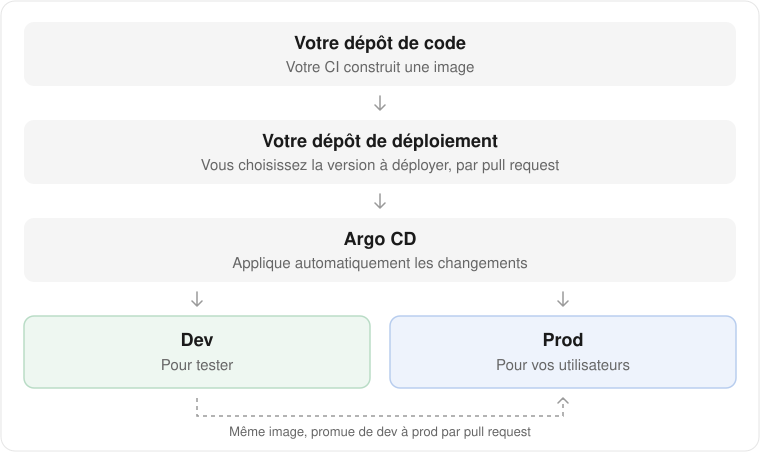
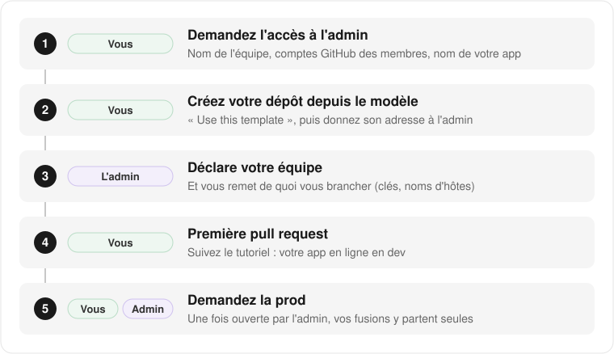

# Comprendre le homelab en 5 minutes

Après cette page, vous saurez comment votre code arrive en production, ce qui relève de vous, et quelle est votre
prochaine action. Les détails viennent ensuite : le [tutoriel](https://github.com/aslon/homelab-tenant-template) pour
votre première app, l'[usage courant](usage.md) au quotidien, la [référence](reference.md) pour les règles exactes.

## 1. Ce que vous pouvez héberger

Des **applications web conteneurisées**, avec ou sans base de données. Vous livrez **par git** : vous décrivez dans un
dépôt ce qui doit tourner, la plateforme l'applique. Vous n'avez accès à aucun serveur, et vous n'en avez pas besoin.

Deux limites à accepter avant de commencer :

- **Disponibilité** : un seul serveur sur une fibre domestique, sans engagement de service. Des coupures sont
  possibles.
- **Données** : rien n'est sauvegardé par la plateforme. Une base de données tourne dans votre espace, et vous la
  sauvegardez vous-même.

## 2. Comment fonctionne un déploiement

**Fusionner sur `main`, c'est déployer** : il n'y a pas d'autre geste. La plateforme n'a pas accès à votre dépôt de
code ; elle récupère uniquement les images publiées sur votre registre et les fichiers de votre dépôt de déploiement.

Vos applications sont accessibles en HTTPS par Cloudflare. Aucun port du serveur n'est exposé directement à Internet,
et les accès privés sont protégés par une authentification.

## 3. Dev et production

| | Dev | Prod |
|---|---|---|
| Rôle | Essayer, valider une version | Servir vos utilisateurs |
| Adresse | `https://<app>-dev.alson-lab.fr` | `https://<app>.alson-lab.fr` |
| Qui voit l'app | Votre équipe seulement | Tout Internet (ou votre équipe, sur demande) |

Les deux environnements sont identiques et appliquent les mêmes règles. Une version passe de dev à prod **par une
pull request qui recopie la même image** : on met en production ce qui a été testé, sans reconstruire. Les données
et les secrets, eux, restent propres à chaque environnement.

## 4. Qui fait quoi, et ce qui est garanti

Votre code arrive en production sans relecture de l'admin. Ce sont les règles de la plateforme qui le permettent :

- **Chaque application est isolée** des autres et soumise à des restrictions de réseau, de permissions et de
  ressources, afin de limiter les risques pour les autres équipes.
- **Seuls les membres déclarés de votre équipe** accèdent à vos outils et à votre app de dev, avec leur compte GitHub
  et une double authentification.
- **Ce qui sort des règles est refusé** à l'entrée, et une vérification automatique vous le signale dès la pull
  request, avant la fusion.
- **Les secrets ne sont jamais en clair** dans git : ils sont chiffrés pour un seul environnement.

| La plateforme garantit | Vous êtes responsable de |
|---|---|
| L'isolation entre équipes | La relecture de ce que vous fusionnez : une fusion part en production |
| Le refus de ce qui sort des règles | La protection de votre branche `main` (revue obligatoire) |
| L'accès réservé aux membres déclarés | L'authentification de votre app en prod, ouverte à Internet |
| Le chiffrement des secrets | **La sauvegarde de vos données** |

Sur cette plateforme, un volume retiré de votre dépôt est supprimé avec ses données (c'est le comportement
configuré) : l'[usage courant](usage.md#vos-données) explique comment le protéger et comment sauvegarder.

## 5. Comment commencer

**Pour commencer**, il vous faut seulement : savoir utiliser git et GitHub (branches, pull requests), savoir
construire une image Docker, et un compte GitHub par membre. Le modèle fournit une app d'exemple prête à déployer :
vous n'écrivez aucun fichier Kubernetes pour votre premier déploiement.

**Selon vos besoins, plus tard** : les bases de Kubernetes pour adapter l'exemple à votre app, `kubeseal` pour les
secrets, `kubectl` pour lire l'état de vos apps en dev. Chaque outil est présenté au moment où il sert.

Le [modèle](https://github.com/aslon/homelab-tenant-template) se trouve sur GitHub ; à l'étape 1, l'admin a besoin du nom de l'équipe, des comptes GitHub des membres et du nom de votre app.

**Prochaine action** : l'étape 1, puis le [tutoriel du modèle](https://github.com/aslon/homelab-tenant-template#readme).
